# TryHackMe: File and Hash Threat Intel Write-up

Room: [File and Hash Threat Intel](https://tryhackme.com/room/fileandhashthreatintel) (SOC Level 1, Threat Analysis Tools)

Goal: take a suspicious Windows executable, identify it by hash, and enrich it with real threat intelligence platforms (VirusTotal and Hybrid Analysis) instead of relying only on the room's built-in lookup tool. Every screenshot below comes from the real services.

---

## 1. Filename and path heuristics

The lab desktop has a `CTI Files` folder. One file, `payroll.pdf`, stands out immediately:

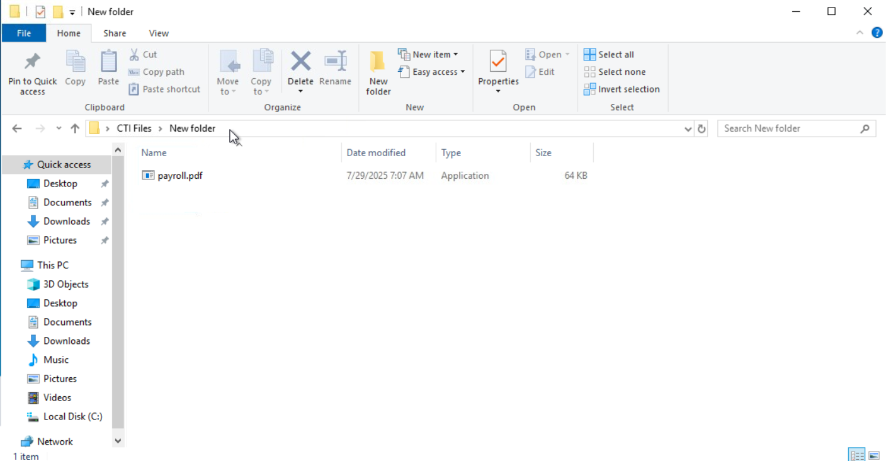

| Property | Value |
|----------|-------|
| Name | `payroll.pdf` |
| Type shown by Windows | **Application** (a real PDF would say "PDF Document") |
| Size | 64 KB |

A "PDF" that Windows classifies as an application is an executable wearing a document name. This is the **double extension / masquerading** heuristic (MITRE T1036.007): Windows hides known extensions by default, so a victim sees `payroll.pdf` and not `payroll.pdf.exe`.

The **Details** tab of the file Properties shows what it is really pretending to be:

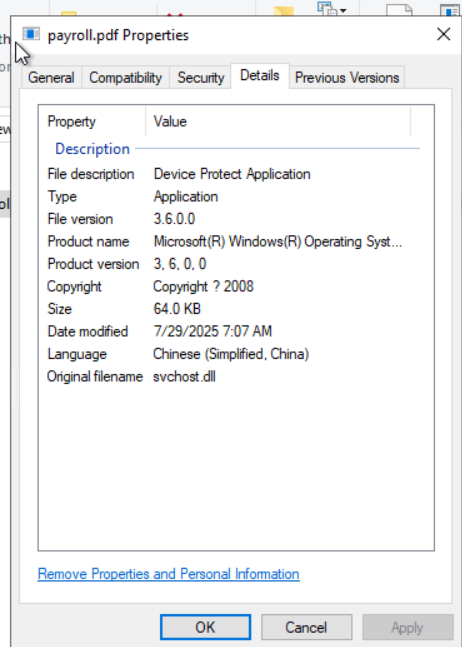

| Field | Value |
|-------|-------|
| File description | Device Protect Application |
| Product name | Microsoft(R) Windows(R) Operating System |
| File version | 3.6.0.0 |
| Copyright | Copyright (C) 2008 |
| Language | Chinese (Simplified, China) |
| **Original filename** | **`svchost.dll`** |

The version information copies a Windows component: the original filename is `svchost.dll`, a name borrowed from the legitimate Windows service host `svchost.exe`. A genuine PDF has none of this metadata, and the Chinese (Simplified) language does not match a Windows system file. This is **system binary impersonation**.

### Hash and VirusTotal

Hashing the file:

```powershell
Get-FileHash -Algorithm SHA256 ".\New folder\payroll*"
```

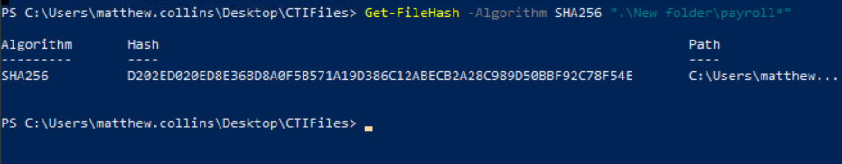

```
d202ed020ed8e36bd8a0f5b571a19d386c12abecb2a28c989d50bbf92c78f54e
```

Searching it on VirusTotal:

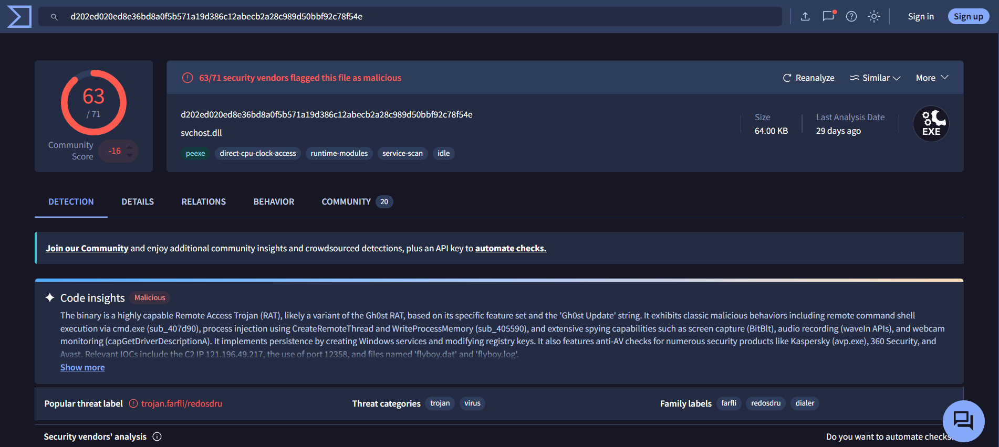

- **63 of 71** vendors flag it as malicious, size 64 KB, known as `svchost.dll`.
- Popular threat label `trojan.farfli/redosdru`; categories trojan and virus; family labels `farfli`, `redosdru`, `dialer`.
- VirusTotal Code insights describe a Remote Access Trojan, likely a **Gh0st RAT** variant: remote command shell through `cmd.exe`, process injection (`CreateRemoteThread`, `WriteProcessMemory`), screen capture, audio recording, webcam monitoring, persistence through Windows services and registry keys, and checks for security products (Kaspersky, 360 Security, Avast).
- Code insights also mention a C2 IP `121.196.49.217`, port `12358`, and files `flyboy.dat` and `flyboy.log`. These come from an automated summary, so they are leads to verify, not confirmed facts.

The room's sandbox report for this file adds:

- **Associated URL** (defanged): `hxxp://121.182.174.27:3000/server.exe`. A raw IP on port 3000 serving an `.exe` is typical of a second stage download.
- **Extracted strings:** 454 identified by the sandbox.

Name and path heuristics are only a first clue. Attackers rename files constantly, so the next step is to identify the file by its hash.

---

## 2. Hashing the sample

The second sample, `bl0gger.exe`, was hashed in PowerShell:

```powershell
Get-FileHash -Algorithm SHA256 bl0gger.exe
```

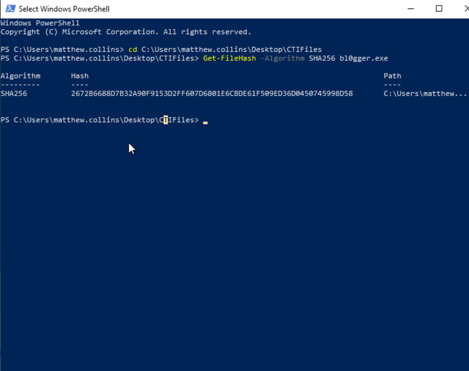

```
2672b6688d7b32a90f9153d2ff607d6801e6cbde61f509ed36d0450745998d58
```

Good practice: store hashes in lowercase, and keep the context (where and when it was seen) next to the hash. Any single byte change produces a different hash, so the hash identifies this exact file regardless of its name.

| Hash | Value |
|------|-------|
| MD5 | `de30aa2610c11376251cba21a9323c83` |
| SHA-1 | `eff8ed1e41e81933909f201ccb1ca7461841684e` |
| SHA-256 | `2672b6688d7b32a90f9153d2ff607d6801e6cbde61f509ed36d0450745998d58` |
| imphash | `0a16a06cf586b598d76b4843b67cf2de` |

---

## 3. VirusTotal

Searching the SHA-256 on VirusTotal:

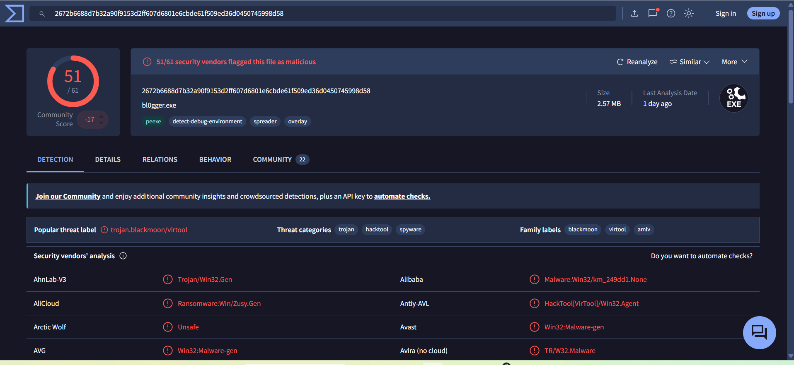

- **51 of 61** vendors flag it as malicious.
- Popular threat label: `trojan.blackmoon/virtool`, categories: trojan, hacktool, spyware.
- Family labels: `blackmoon`, `virtool`, `amlv`.
- File tags: `peexe`, `detect-debug-environment`, `spreader`, `overlay`.
- Size 2.57 MB, filename `bl0gger.exe`.

A high detection ratio with consistent family naming across vendors is strong evidence. Conflicting labels or very low counts would call for caution.

---

## 4. Hybrid Analysis (sandbox)

The [Hybrid Analysis report](https://hybrid-analysis.com/sample/2672b6688d7b32a90f9153d2ff607d6801e6cbde61f509ed36d0450745998d58) confirms the verdict with behaviour, not just signatures:

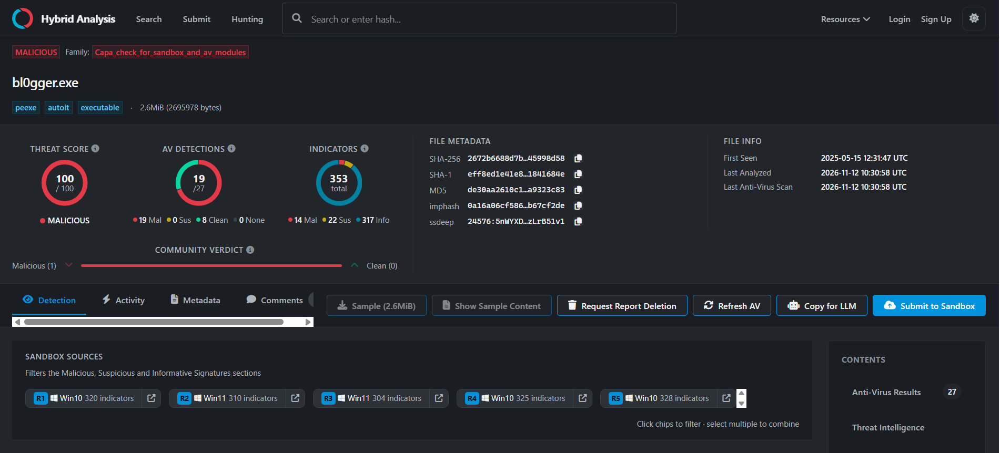

| Item | Value |
|------|-------|
| Threat score | **100 / 100** |
| AV detections | 19 / 27 |
| Indicators | 353 (14 malicious, 22 suspicious, 317 informative) |
| Tags | `peexe`, `autoit`, `executable` |
| Matched rule family | `Capa_check_for_sandbox_and_av_modules` |
| First seen | 2025-05-15 12:31:47 UTC |
| Sandbox runs | 5 (Windows 10 and Windows 11) |

The `autoit` tag means the executable is a compiled AutoIt script, a common way to pack and hide code. The capa rule name tells us the sample checks for sandbox and antivirus modules, so it tries to detect analysis.

### Antivirus naming

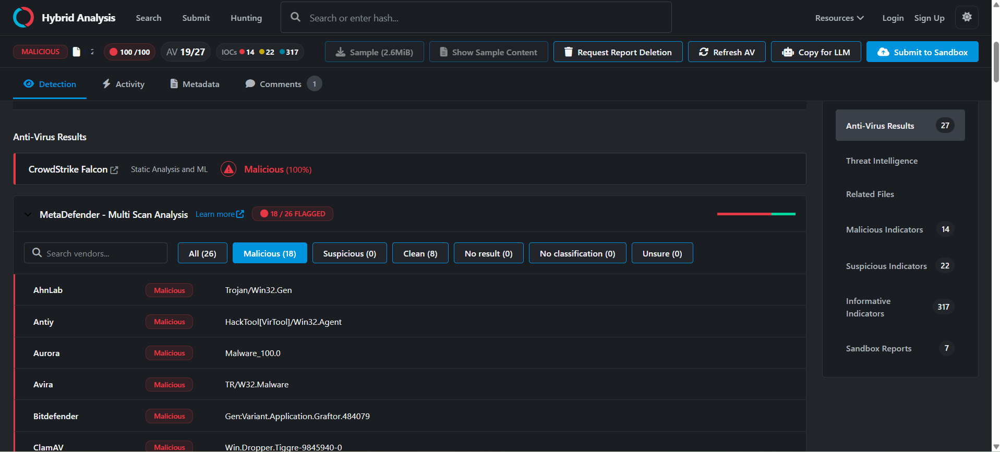

Vendor names point to the same family: Sophos `App/Blamon-B`, Varist `W32/BlackMoon.DD`, Zillya `Tool.FlyStudio.Win32.43`, Bitdefender `Gen:Variant.Application.Graftor.484079`. The sample looks like a **BlackMoon** banking-trojan family member built with **FlyStudio**. The long filename that appears in some reports (`..._agent-tesla_amadey_..._smoke-loader.exe`) is a list of YARA matches, not proof that it is all of those families.

### Relationship graph

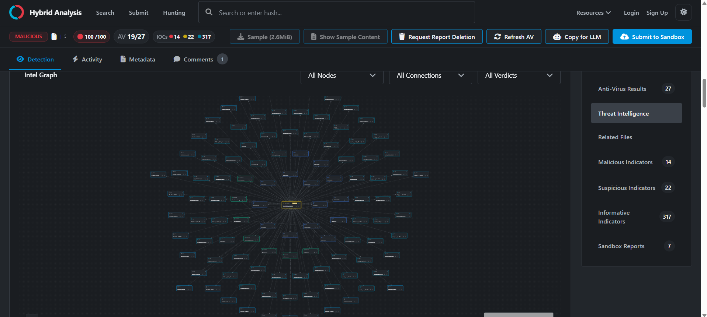

The intel graph links the sample to many related files and indicators. Several `bl0gger.exe` copies with different hashes are also rated malicious, which shows how widely this binary is reused.

---

## 5. Process tree

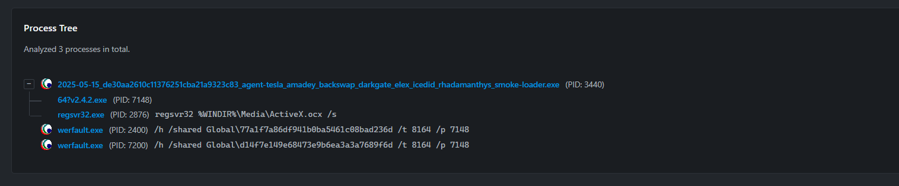

```
bl0gger.exe (PID 3440)
├── 64?v2.4.2.exe (PID 7148)
├── regsvr32.exe (PID 2876)   regsvr32 %WINDIR%\Media\ActiveX.ocx /s
├── werfault.exe (PID 2400)   /h /shared Global\... /t 8164 /p 7148
└── werfault.exe (PID 7200)   /h /shared Global\... /t 8164 /p 7148
```

- The **stealth command line** is `regsvr32 %WINDIR%\Media\ActiveX.ocx /s`. The `/s` flag runs it silently, with no dialog. Abusing `regsvr32` to run a DLL is a known signed-binary proxy execution technique.
- `64?v2.4.2.exe` is a dropped second executable.
- The two `werfault.exe` entries are the Windows error reporter. They appear because process 7148 crashed in the sandbox, which also shows how analysis sometimes fails.

---

## 6. Network indicators

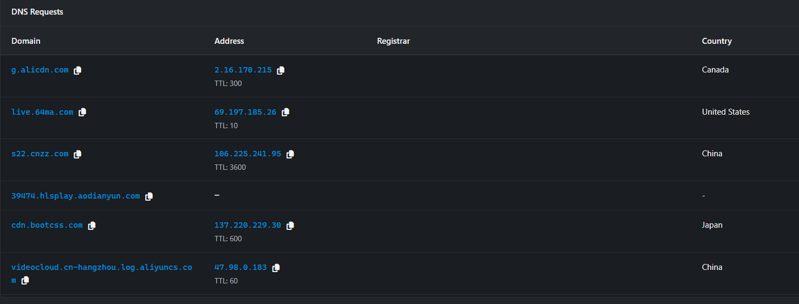

| Domain | IP | Country |
|--------|----|---------|
| `g.alicdn.com` | 2.16.170.215 | Canada |
| `live.64ma.com` | 69.197.185.26 | United States |
| `s22.cnzz.com` | 106.225.241.95 | China |
| `39474.hlsplay.aodianyun.com` | none resolved | none |
| `cdn.bootcss.com` | 137.220.229.30 | Japan |
| `videocloud.cn-hangzhou.log.aliyuncs.com` | 47.98.0.183 | China |

Most of these are Chinese CDN and analytics services, which matches BlackMoon. Caution: CDN domains such as `g.alicdn.com` and `cdn.bootcss.com` also appear in normal traffic, so they are context, not standalone blocking indicators.

### Pivoting on a domain

Checking `live.64ma.com` on VirusTotal:

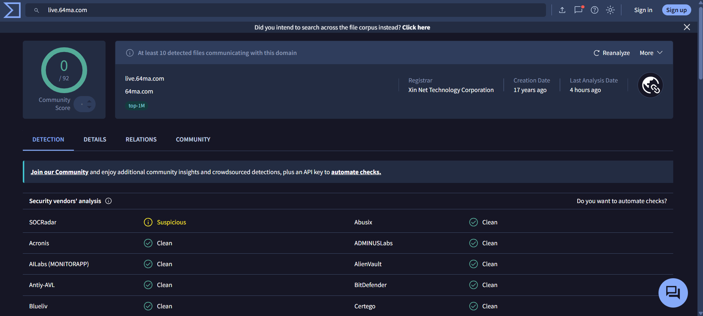

The domain scores **0/92** and is in the top one million sites, but VirusTotal also reports **at least 10 detected files communicating with it**. A clean domain reputation does not mean the domain is not abused. The useful pivot is the **Relations** tab, which lists the malware that talks to it.

---

## 7. Behaviour summary

Observed in the Hybrid Analysis report:

- Spawns `regsvr32` silently to load an `.ocx`.
- Writes data to a remote process.
- Sets a global Windows hook to intercept mouse events.
- Tries to steal mail credentials from the registry.
- Checks for virtual environments, sleeps many times, and checks for debuggers.
- Marks its own file for deletion.
- POSTs data to a web server using a browser-like user-agent, on unusual ports.
- Modifies proxy settings.

---

## 8. Challenge: `Challenge.bin.sample`

The last task gives an unknown sample, `Challenge.bin.sample` (1,048,576 bytes), and asks to identify it with the same workflow.

```powershell
Get-FileHash -Algorithm SHA256 .\Challenge.bin.sample
```

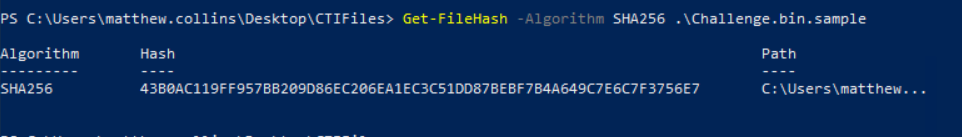

```
43b0ac119ff957bb209d86ec206ea1ec3c51dd87bebf7b4a649c7e6c7f3756e7
```

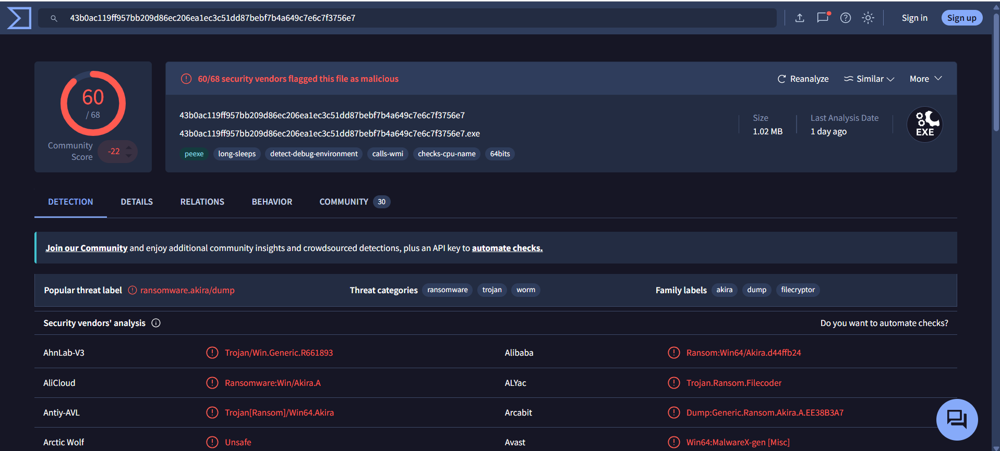

| Item | Value |
|------|-------|
| VirusTotal detections | **60 / 68** malicious |
| Popular threat label | `ransomware.akira/dump` |
| Threat categories | ransomware, trojan, worm |
| Family labels | `akira`, `dump`, `filecryptor` |
| Type | Win64 PE, 1.02 MB |
| Tags | `long-sleeps`, `detect-debug-environment`, `calls-wmi`, `checks-cpu-name`, `64bits` |

Vendors agree on **Akira ransomware** (for example `Ransom:Win64/Akira`, `Trojan[Ransom]/Win64.Akira`, `Ransomware:Win/Akira.A`). The `long-sleeps`, debugger and CPU-name checks are sandbox and analysis evasion, and `calls-wmi` is the kind of behaviour ransomware uses to delete shadow copies.

From the room's lookup: the file was first **submitted on 2023-07-10 08:22:15** and it drops a ransom note named **`akira_readme.txt`** in every directory it encrypts. The note contains payment instructions and Tor links for negotiation.

---

## Indicators of compromise

| Type | Value |
|------|-------|
| SHA-256 | `2672b6688d7b32a90f9153d2ff607d6801e6cbde61f509ed36d0450745998d58` |
| SHA-1 | `eff8ed1e41e81933909f201ccb1ca7461841684e` |
| MD5 | `de30aa2610c11376251cba21a9323c83` |
| SHA-256 (Challenge) | `43b0ac119ff957bb209d86ec206ea1ec3c51dd87bebf7b4a649c7e6c7f3756e7` |
| Ransom note | `akira_readme.txt` |
| Filename | `bl0gger.exe` |
| Filename | `payroll.pdf` (really an executable, original name `svchost.dll`) |
| SHA-256 (payroll) | `d202ed020ed8e36bd8a0f5b571a19d386c12abecb2a28c989d50bbf92c78f54e` |
| IP (unverified, from VT insights) | `121.196.49.217` port `12358` |
| Files (unverified) | `flyboy.dat`, `flyboy.log` |
| URL (defanged) | `hxxp://121.182.174.27:3000/server.exe` |
| IP | `121.182.174.27` (port 3000) |
| Dropped file | `64?v2.4.2.exe` |
| Command line | `regsvr32 %WINDIR%\Media\ActiveX.ocx /s` |
| Domain | `live.64ma.com` |
| Domain | `39474.hlsplay.aodianyun.com` |
| Domain | `s22.cnzz.com` |
| Context only | `g.alicdn.com`, `cdn.bootcss.com`, `videocloud.cn-hangzhou.log.aliyuncs.com` |

## MITRE ATT&CK mapping

Mapped by hand from the behaviours above (the Hybrid Analysis matrix lists many more techniques).

| Tactic | Technique |
|--------|-----------|
| Defense Evasion | T1218.010 Regsvr32 |
| Defense Evasion | T1055 Process Injection |
| Defense Evasion | T1497.001 / T1497.003 Sandbox evasion (system checks, time based) |
| Defense Evasion | T1622 Debugger Evasion |
| Defense Evasion | T1027.002 Software Packing |
| Defense Evasion | T1070.004 File Deletion |
| Defense Evasion | T1036.007 Double File Extension (`payroll.pdf`) |
| Credential Access | T1552.002 Credentials in Registry |
| Impact | T1486 Data Encrypted for Impact (Akira sample) |
| Persistence | T1543.003 Windows Service (payroll sample) |
| Execution | T1059.003 Windows Command Shell (payroll sample) |
| Collection | T1113 Screen Capture, T1123 Audio Capture, T1125 Video Capture (payroll sample) |
| Defense Evasion | T1562.001 Disable or Modify Tools, anti-AV checks (payroll sample) |
| Collection | T1056 Input Capture |
| Discovery | T1614 System Location Discovery |
| Command and Control | T1071.001 Web Protocols |
| Command and Control | T1571 Non-Standard Port |

## Takeaways

- A file name or type that does not match its content (`payroll.pdf` shown as an application) is an immediate red flag.
- The hash identifies the file whatever it is called. Hash first, then search it.
- Compare several sources. VirusTotal and Hybrid Analysis use different engines, so the numbers differ (51/61 against 19/27) but agree on the verdict.
- Treat vendor family names as hints. Names of YARA matches are not always the real family.
- Sandboxes have limits: the sample crashed (`werfault.exe`), and it checks for sandboxes, so a clean or partial run is never proof of safety.
- A domain with a clean score can still be used by malware. Check which files communicate with it.
